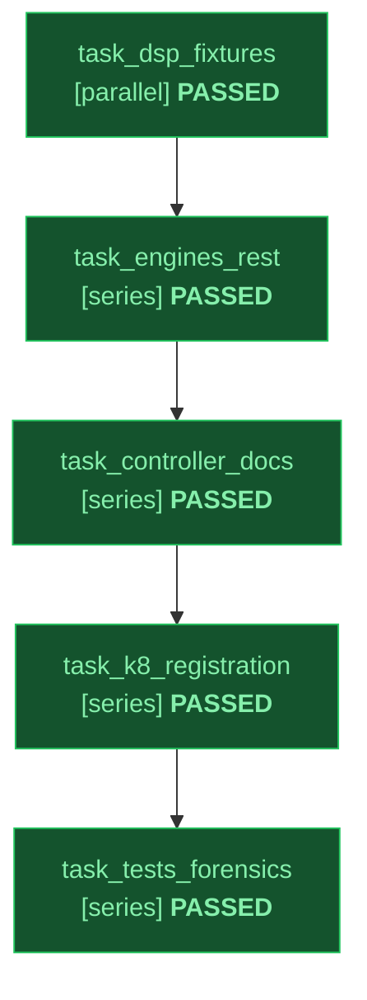

# Implementation Plan: Grounded Audio Generation & Mastering Skill (`audio-gen`)

Status: approved
Slug: audio-gen-cli
Path: architectural
Spec: docs/design/audio-gen-cli-spec.md

---

## 1. Shared Inter-Skill & Module Contracts

### 1.1 Sibling Skill & CLI Contract (`skills/audio-gen/scripts/audio_gen.py`)
`audio_gen.py` exposes deterministic CLI flags synced 1:1 with `skills/audio-gen/SKILL.md` (`S6`) and callable by sibling media workflows (`skills/video-gen`, `skills/codelab`, `skills/atelier`):
- `--prompt` / `-p`, `--text-file`, `--mode {auto,bgm,song,backing-track,voice,dialogue,voice-design,voice-replicate,sfx,stinger,mix}`, `--engine {auto,lyria,gemini-tts,chirp3,voices-rest,sfx,mix}`, `--output` / `-o`
- `--spec-file`, `--spec-out`, `--model` / `-m`, `--verifier-model`, `--max-attempts`
- `--lyrics`, `--lyrics-file`, `--genre`, `--bpm`, `--key`, `--mood`, `--instruments`, `--language` / `--locale`, `--duration`, `--crossfade`, `--image-ref` / `-i`, `--strip-vocals-from`
- `--voice-name`, `--delivery-style` / `--style`, `--speakers`, `--chunk-chars`, `--voice-prompt`, `--sample-text`, `--source-audio`, `--consent-audio`, `--ephemeral`, `--voice-meta-out`, `--speaking-rate`, `--pronunciations`, `--chirp-cloning-key`
- `--sfx-engine {auto,omni-foley,lyria-sting,lavfi-synth,creative-bed}`, `--bed-style`, `--voice-track`, `--bgm-track`, `--sfx-cue`, `--clean-voice`, `--lead`, `--tail`, `--bgm-gain-db`, `--duck-db`, `--lufs-target`, `--true-peak-dbtp`, `--no-normalize`, `--reaper-rpp`, `--creative-stack`
- `--require-ffmpeg`, `--no-verify`, `--allow-unverified`, `--override-reason`, `--dry-run`, `--doctor`

### 1.2 Shared Verifier & Deprecation Constants (`T6` Parity)
`skills/audio-gen/scripts/audio_engines.py` and `skills/audio-gen/scripts/audio_gen.py` expose `VERIFIER_MODEL_CHAIN = ("gemini-4-argon", "gemini-4-carbon", "gemini-3.8-flash")` and `DEPRECATED_MODEL_PREFIXES` matching `image_gen.py` and `video_gen.py` byte-for-byte, plus audio-specific `DEPRECATED_AUDIO_MODEL_PREFIXES` (`gemini-2.5-flash-preview-tts`, `gemini-2.5-pro-preview-tts`, `gemini-3.1-flash-tts-preview`, `chirp-2`, `wavenet`, `neural2`, `standard-`, `lyria-1`, `lyria-2`).

---

## 2. Declarative Task Graph (DAG)

Topology: full | Integrity Mode: development

| ID | Task Name | Mode | Depends On | Inputs | Outputs | Gate | Status |
|---|---|---|---|---|---|---|---|
| task_dsp_fixtures | Author Verifier Fixtures and Pure-Stdlib Binary DSP & Mastering Module | parallel | none | docs/design/audio-gen-cli-spec.md | skills/audio-gen/scripts/audio_dsp.py, skills/audio-gen/fixtures/known_good/valid_sine.wav, skills/audio-gen/fixtures/known_bad/digital_silence.wav | python3 scripts/check_stdlib_only.py --root skills/audio-gen/scripts | PASSED |
| task_engines_rest | Build Lyria, Gemini 3.8 TTS, /v1beta/voices, Chirp 3 HD, and SFX Engines | series | task_dsp_fixtures | docs/design/audio-gen-cli-spec.md, skills/audio-gen/scripts/audio_dsp.py | skills/audio-gen/scripts/audio_engines.py | python3 scripts/check_stdlib_only.py --root skills/audio-gen/scripts | PASSED |
| task_controller_docs | Build Closed-Loop audio_gen.py Controller, SKILL.md, DESIGN.md, and References | series | task_engines_rest | skills/audio-gen/scripts/audio_dsp.py, skills/audio-gen/scripts/audio_engines.py | skills/audio-gen/scripts/audio_gen.py, skills/audio-gen/SKILL.md, skills/audio-gen/DESIGN.md, skills/audio-gen/README.md | python3 scripts/validate_skills.py | PASSED |
| task_k8_registration | Wire Five-Place K8 Skill Registration, Autowire Matrix, and Stdlib Enforcement | series | task_controller_docs | skills/audio-gen/SKILL.md, scripts/sync_skills.py, config/harnesses.json | scripts/sync_skills.py, config/harnesses.json, skills/work/scripts/autowire.py, scripts/check_stdlib_only.py | python3 skills/work/scripts/autowire.py --check | PASSED |
| task_tests_forensics | Execute T1-T6 Test Suite, 100% Mutation Smoke, Review Collector, and Scanners | series | task_k8_registration | skills/audio-gen/scripts/audio_gen.py, scripts/sync_skills.py | skills/audio-gen/tests/test_audio_gen.py | python3 -m pytest -q skills/audio-gen/tests | PASSED |

