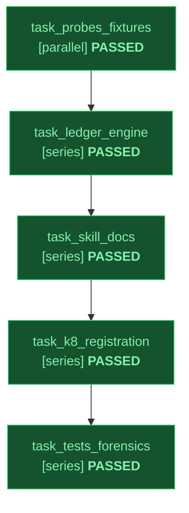

# Implementation Plan: Horizon Sentinel Skill (`skills/horizon`)

Status: approved
Slug: horizon-sentinel
Path: architectural
Spec: docs/design/horizon-sentinel-spec.md

---

## 1. Module Contracts & Verification Gates

1. **`skills/horizon/scripts/horizon_probes.py`**: 100% Python 3.12 stdlib mechanical probe collectors (`cli_help`, `github_release`, `http_digest`, `file_anchor`, `gh_pr_status`, `agent_query`), JSON-preserving `S8` capture-time secret redaction, SSRF scheme/redirect checks, and CWE-88 CLI argument validation.
2. **`skills/horizon/scripts/horizon.py`**: Central ledger resolution (`--ledger-dir` -> `$FORGE_HORIZONS_DIR` -> `~/.gemini/horizons`), `record`, `list`, `collect-evidence` (`--reconcile-prs`), `validate-verdict`, `backup-target`, `record-action`, `render-index` (`--check`), and `--doctor`.
3. **K8 & CI Gates**: Registered across `scripts/sync_skills.py`, `config/harnesses.json`, `skills/work/scripts/autowire.py`, `scripts/check_stdlib_only.py`, `README.md`, and `docs/catalog_reference.md`, verified by `T1-T6`, `forensic_audit.py --strict --mutate`, `validate_skills.py`, and `gitleaks`.

---

## 2. Declarative Task Graph (DAG)

Topology: full | Integrity Mode: development

| ID | Task Name | Mode | Depends On | Inputs | Outputs | Gate | Status |
|---|---|---|---|---|---|---|---|
| task_probes_fixtures | Build horizon_probes.py Collectors and Known-Good/Known-Bad Fixtures | parallel | none | docs/design/horizon-sentinel-spec.md | skills/horizon/scripts/horizon_probes.py, skills/horizon/fixtures/known_good/passing_verdict.json, skills/horizon/fixtures/known_bad/corrupt_ledger.jsonl | python3 scripts/check_stdlib_only.py --root skills/horizon/scripts | PASSED |
| task_ledger_engine | Build horizon.py Ledger CLI, L3 Verdict Gate, and Backup/PR Provenance | series | task_probes_fixtures | docs/design/horizon-sentinel-spec.md, skills/horizon/scripts/horizon_probes.py | skills/horizon/scripts/horizon.py | python3 scripts/check_stdlib_only.py --root skills/horizon/scripts | PASSED |
| task_skill_docs | Author SKILL.md, DESIGN.md, README.md, and Progressive References | series | task_ledger_engine | skills/horizon/scripts/horizon.py, docs/ENGINEERING_STANDARD.md | skills/horizon/SKILL.md, skills/horizon/DESIGN.md, skills/horizon/README.md, skills/horizon/references/ledger_and_probes.md, skills/horizon/references/remediation_and_automation.md | python3 scripts/validate_skills.py | PASSED |
| task_k8_registration | Wire K8 Five-Place Registration, Autowire Domain, and Stdlib Enforcement | series | task_skill_docs | skills/horizon/SKILL.md, scripts/sync_skills.py, config/harnesses.json | scripts/sync_skills.py, config/harnesses.json, skills/work/scripts/autowire.py, scripts/check_stdlib_only.py, README.md, docs/catalog_reference.md | python3 skills/work/scripts/autowire.py --check | PASSED |
| task_tests_forensics | Execute T1-T6 Test Suite, 100% Mutation Smoke, Review Collector, and Gitleaks | series | task_k8_registration | skills/horizon/scripts/horizon.py, skills/horizon/scripts/horizon_probes.py | skills/horizon/tests/test_horizon.py, skills/work/tests/test_autowire.py, tests/test_stdlib_only.py | python3 -m pytest -q skills/horizon/tests | PASSED |

