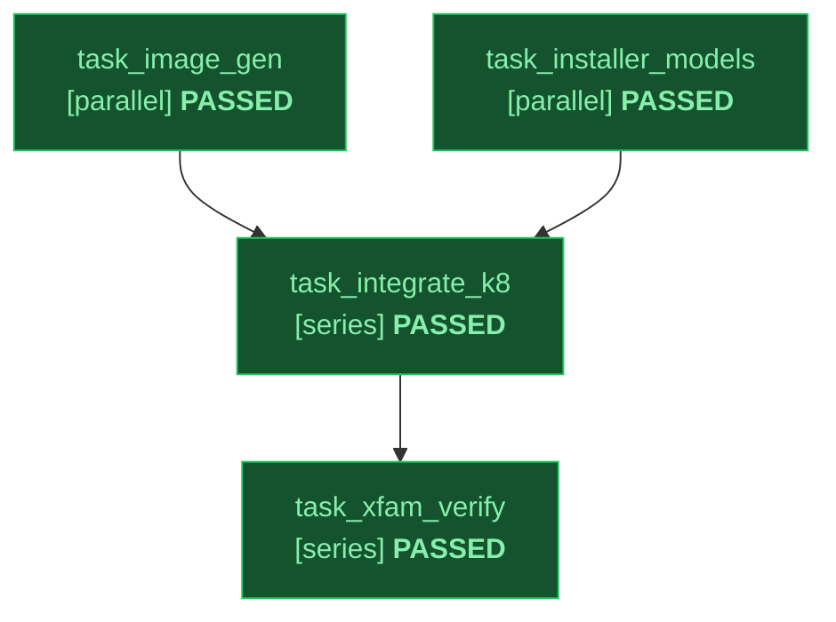

# Implementation Plan: Image-Gen CLI Migration & Media Tools (`image-gen`)

Status: approved
Slug: image-gen-cli
Path: architectural
Spec: docs/design/image-gen-cli-spec.md

---

## 1. Skill Contracts & Shared Constants

### 1.1 `image_gen.py` CLI Invocation Contract
`skills/image-gen/scripts/image_gen.py` MUST accept these exact flags:
- `--prompt <str>` (required unless `--spec-file`, `--manifest`, `--verify-only`, or `--doctor` is passed)
- `--spec-file <json_path>` (load a pre-compiled `VisualRequirementSpec` JSON file)
- `--mode {auto,single,diagram,comic-grid,comic-panels,timeline}` (default: `auto`)
- `--style <str>` (optional art-direction string)
- `--reference <path>` / `-r <path>` / `--references <path>` (repeatable `action="append"`, also accepts comma-separated paths, max 14)
- `--ar {1:1,2:3,3:2,3:4,4:3,4:5,5:4,9:16,16:9,21:9,1:4,4:1,1:8,8:1}` (default: `1:1`)
- `--size {1K,2K,4K}` (default: `1K`, auto-upgraded to `2K` when `mode == "comic-grid"` or dense quoted text is detected)
- `--output <path>` / `-o <path>` (default: `output.png`)
- `--manifest <json_path>` (for multi-frame `comic-panels` and `timeline` sequences; writes `<output_dir>/keyframes_manifest.json` or `--manifest-out <path>`)
- `--manifest-out <json_path>` (optional path to write `keyframes_manifest.json`)
- `--previous-interaction-id <id>`
- `--model <id>` (default: `gemini-nano-banana-2.1`; `comic-grid` auto-promotes `gemini-3-pro-image` when `--model` is not explicitly passed)
- `--verifier-model <id>` (default: `gemini-4-argon`, restricted to `VERIFIER_MODEL_CHAIN`)
- `--max-attempts <int>` (default: `3`)
- `--raw-prompt` / `--expand-prompt` (skip or enable Argon prompt expansion)
- `--no-verify` (skip Stage 4 multimodal rubric judge; mechanical Stage 3 still runs unless `--dry-run`)
- `--allow-unverified` (requires `--override-reason "<why>"`, `exit 2` if omitted; writes output with loud `stderr` `WARNING`, `.report.json`, and `UNVERIFIED_OVERRIDE` provenance on retry exhaustion)
- `--override-reason <str>` (mandatory non-empty justification string recorded when `--allow-unverified` is used)
- `--verify-only <path>` / `--rubric-file <json_path>` (offline mechanical + rubric verification of an existing image)
- `--dry-run` (validates spec, constraints, and emits planned `gemini-api` command JSON to stdout without network calls; exits `0`)
- `--doctor` (checks `gemini-api` binary, version, and redacted `whoami` auth status; exits `0` when ready, `1` when `gemini-api` is missing)

### 1.2 `keyframes_manifest.json` Output Schema
```json
{
  "schema_version": 1,
  "mode": "timeline",
  "style": "cinematic storyboard",
  "aspect_ratio": "16:9",
  "anchor_image": "frames/anchor.png",
  "frames": [
    {
      "index": 1,
      "path": "frames/frame_01.png",
      "response_id": "v1_abc",
      "prompt": "Wide establishing shot...",
      "caption": "Step 1",
      "duration_s": 6
    }
  ]
}
```

### 1.3 Model & Deprecation Constants
`skills/image-gen/scripts/image_gen.py` exposes module-level constants:
- `VERIFIER_MODEL_CHAIN = ("gemini-4-argon", "gemini-4-carbon", "gemini-3.8-flash")`
- `DEPRECATED_MODEL_PREFIXES = ("gemini-1.5", "gemini-2.0", "gemini-2.5", "gemini-3.1-flash-image", "gemini-3-pro-image-preview", "gemini-3.1-pro", "imagen-", "veo-2", "veo-3.1", "gemini-omni-flash-preview")`
  - Note: `"gemini-3.1-flash-lite-image"` is explicitly allowed ONLY as the unreferenced 1-shot `#2` image backup; `"gemini-3.1-flash-image"` (exact) is blocked.

---

## 2. Declarative Task Graph (DAG)

Topology: full | Integrity Mode: development

| ID | Task Name | Mode | Depends On | Inputs | Outputs | Gate | Status |
|---|---|---|---|---|---|---|---|
| task_image_gen | Rebuild image-gen Skill on gemini-api CLI with Fixtures and Tests | parallel | none | docs/design/image-gen-cli-spec.md | skills/image-gen/SKILL.md, skills/image-gen/DESIGN.md, skills/image-gen/scripts/image_gen.py, skills/image-gen/tests/test_image_gen.py | python3 -m pytest -q skills/image-gen/tests | PASSED |
| task_installer_models | Add --with-media-tools Opt-In and Deprecate Legacy Model Configs | parallel | none | docs/design/image-gen-cli-spec.md, scripts/install.sh, scripts/install.ps1 | scripts/install.sh, scripts/install.ps1, tests/test_install_media_tools.py, skills/verify/references/persona_roles.md | python3 -m pytest -q tests/test_install_media_tools.py | PASSED |
| task_integrate_k8 | Wire Registration, Autowire, Stdlib Enforcement, and P3 Closure | series | task_image_gen, task_installer_models | skills/image-gen/SKILL.md, scripts/sync_skills.py, scripts/check_stdlib_only.py | config/harnesses.json, skills/work/scripts/autowire.py, scripts/check_stdlib_only.py, docs/catalog_reference.md | python3 -m pytest -q | PASSED |
| task_xfam_verify | Cross-Family Fresh-Context Adversarial Review and CI Proof | series | task_integrate_k8 | scripts/sync_skills.py, skills/image-gen/scripts/image_gen.py, scripts/install.sh, scripts/install.ps1 | docs/design/image-gen-cli-plan.md | python3 scripts/validate_skills.py | PASSED |


