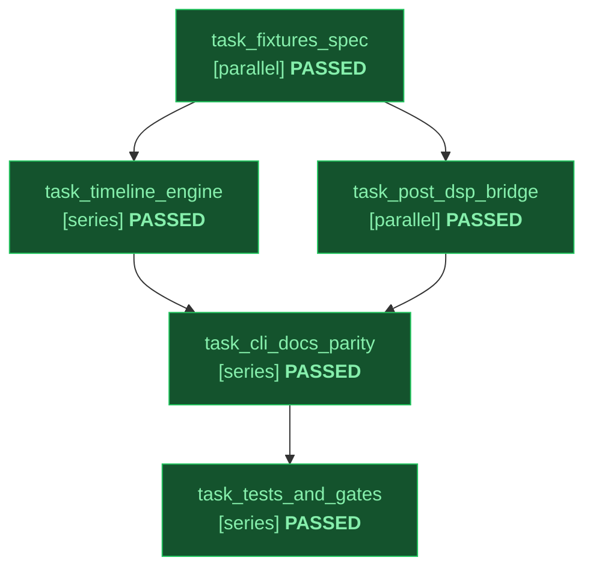

# Implementation Plan: Arbitrary-Length Video Generation, Broadcast Audio & Creative-Stack Bridge (`video-gen`)

Status: approved
Slug: video-gen-cli
Path: architectural
Spec: docs/design/video-gen-cli-spec.md

---

## 1. Modular Contracts & Invariants

1. **Three-Module Stdlib Architecture (`skills/video-gen/scripts/`)**:
   - `video_gen.py`: CLI parser (`S6`), constraint gates (`exit 2`), frozen `VisualRequirementSpec` (`TEXT_AC` OCR criteria), single-clip Omni 1.2 loop, blinded `gemini-4-argon` rubric verification, `--doctor`, and orchestration.
   - `video_timeline.py`: arbitrary-duration (`3s..3600s+`) planner (`timeline_plan.json`), `--script <json|md>` parser, `keyframe-chain` / `scene-cuts` / `extend-blocks` chainer, `ffmpeg -sseof -0.05` boundary extractor, `image-gen` keyframe delegation, and `concat` / `xfade`+`acrossfade` stitcher.
   - `video_post.py`: `SECRET_PATTERNS` (including bare `key=<16+ chars>`), `creative-stack` (`vidkit` & `sound`) discovery, keg-only `ffmpeg-full` resolver + `-filters` capability probe, SRT/JSON + audio magic-byte validators, caption/card compositing (`mov_text` & stdlib RGBA PNG card fallbacks), and 2-pass `-14 LUFS` `48 kHz` (`dual_mono=true`, `volume` ducking, `amix=normalize=0`) audio mastering.
2. **Cross-Skill Parity (`skills/image-gen` + `skills/video-gen`)**:
   - Identical `VERIFIER_MODEL_CHAIN`, `DEPRECATED_MODEL_PREFIXES`, `SECRET_PATTERNS` labels, and mandatory `--override-reason` on `--allow-unverified` (`exit 2` when omitted).

---

## 2. Declarative Task Graph (DAG)

Topology: full | Integrity Mode: development

| ID | Task Name | Mode | Depends On | Inputs | Outputs | Gate | Status |
|---|---|---|---|---|---|---|---|
| task_fixtures_spec | Author Grounded Spec and Verifier Known-Bad and Known-Good Fixtures | parallel | none | docs/ENGINEERING_STANDARD.md | docs/design/video-gen-cli-spec.md, skills/video-gen/fixtures/known_bad/corrupt_captions.srt, skills/video-gen/fixtures/known_bad/non_audio_bgm.mp3, skills/video-gen/fixtures/known_good/timeline_plan_45s_keyframe_chain.json | python3 scripts/check_stdlib_only.py | PASSED |
| task_timeline_engine | Extract video_timeline.py for Arbitrary-Length Chaining and xfade Stitching | series | task_fixtures_spec | docs/design/video-gen-cli-spec.md | skills/video-gen/scripts/video_timeline.py | python3 scripts/check_stdlib_only.py | PASSED |
| task_post_dsp_bridge | Build video_post.py for Creative-Stack Bridge, Captions, Cards, and 2-Pass Loudnorm | parallel | task_fixtures_spec | docs/design/video-gen-cli-spec.md | skills/video-gen/scripts/video_post.py | python3 scripts/check_stdlib_only.py | PASSED |
| task_cli_docs_parity | Wire video_gen.py, image_gen.py Override/Redaction Parity, and Skill References | series | task_timeline_engine, task_post_dsp_bridge | skills/video-gen/scripts/video_timeline.py, skills/video-gen/scripts/video_post.py | skills/video-gen/scripts/video_gen.py, skills/image-gen/scripts/image_gen.py, skills/video-gen/SKILL.md, skills/video-gen/DESIGN.md, skills/video-gen/references/longform_audio_text_and_creative_stack.md | python3 scripts/validate_skills.py | PASSED |
| task_tests_and_gates | Expand T1-T6 Unit, Subprocess Contract, Forensic Mutation, and Scanner Verification | series | task_cli_docs_parity | skills/video-gen/scripts/video_gen.py, skills/video-gen/SKILL.md | skills/video-gen/tests/test_video_gen.py, tests/test_media_cli_contract.py, docs/design/video-gen-cli-plan.md | python3 -m pytest -q skills/video-gen/tests tests/test_media_cli_contract.py | PASSED |

