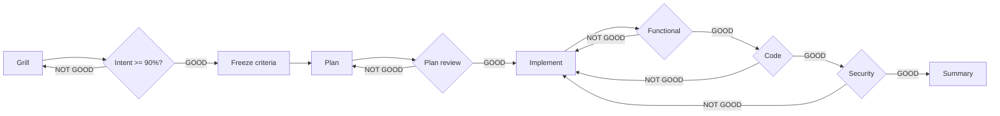

# H2O

**Hydrogen writes, Opus attacks.** A lean, gated swarm for taking one change
from a vague prompt to reviewed, tested code. Gemini 4 Hydrogen plans and
implements; Claude Opus 5.5 reviews every step adversarially; a stdlib script
enforces the gates so "done" means something.

Trigger: `/h2o <task>`, or ask the agent to "run the H2O swarm".

## When to use it

| Use H2O when | Use something else when |
| :--- | :--- |
| One change, one branch, and you want it reviewed hard before it lands | Many independent changes that can run in parallel: use `/work` |
| You want cross-family review without paying Opus rates for authoring | A one-line fix: just do it, or use `/test` |
| Requirements are fuzzy and need grilling before anyone plans | You need design tournaments or competing architectures: use `/work` |
| You want the loop to stop and ask you instead of burning quota | GitHub issue queues end to end: use `/issue-loop` |

## How it works



1. **Grill and intent review.** The coordinator asks you one question at a
   time and records the answers in `.agents/h2o/REQUIREMENTS.md`. An Opus
   `intent-reviewer` attacks it for ambiguity until it judges >= 90% clarity.
2. **Done criteria.** A criteria writer turns the answers into binary
   acceptance criteria and, where possible, failing acceptance tests. You
   approve them; they are then frozen by hash and nobody may edit them.
3. **Plan and plan review.** One Hydrogen planner writes the plan; an Opus
   reviewer attacks it against the criteria and the real code.
4. **Implement.** One Hydrogen implementer builds it on `h2o/<slug>`.
5. **Three reviews, in order.** Functional (does it work, can it be broken),
   code (quality, scope, weakened tests), then deep security. Any NOT GOOD
   sends the work back to the implementer, and all three reviews run again.
   A reviewer that finds the plan itself wrong sends it back to the planner.
6. **Limits.** Each gate allows 3 NOT GOOD verdicts. On the third, the swarm
   stops and asks you to stop or continue.
7. **Summary.** A report of each criterion with its evidence, what changed,
   attempts per gate, and remaining risks.

## Roles and models

| Role | Model | Notes |
| :--- | :--- | :--- |
| coordinator | your conversation's model | Grills you, routes work, runs the gate script |
| `intent-reviewer` | `claude-opus-5-5-medium` | Verifies >= 90% clarity in `REQUIREMENTS.md` |
| `criteria-writer` | `gemini-4-hydrogen-high` | |
| `planner` | `gemini-4-hydrogen-xhigh` | |
| `plan-reviewer` | `claude-opus-5-5-medium` | |
| `implementer` | `gemini-4-hydrogen-high` | Moves to `-xhigh` after its first NOT GOOD |
| `functional-reviewer` | `claude-opus-5-5-medium` | |
| `code-reviewer` | `claude-opus-5-5-medium` | |
| `security-reviewer` | `claude-opus-5-5-high` | The only reviewer at `high` |
| `summarizer` | `gemini-4-hydrogen-high` | |
| `monitor` | `gemini-4-hydrogen-medium` | Stall monitor |

These are public Antigravity catalogue IDs. H2O's assignments override any
global swarm routing rules on your machine. If your catalogue serves the same
models under other IDs, the coordinator picks the same family and tier; if a
family or tier is missing, it stops and asks. See
[references/models.md](references/models.md).

## The gate script

[`scripts/h2o_gate.py`](scripts/h2o_gate.py) is stdlib-only Python. It checks
evidence; it never judges quality. All commands print JSON. Exit codes: 0 pass,
1 fail, 2 invocation error, 3 loop cap reached.

| Command | What it checks |
| :--- | :--- |
| `verdict --file <post>` | One `VERDICT:` line, real evidence, numbered findings for NOT GOOD |
| `freeze --state-dir .agents/h2o --file <f> ...` | Hashes the approved criteria and acceptance tests |
| `check-frozen --state-dir .agents/h2o` | Frozen files are unchanged |
| `record --state-dir .agents/h2o --gate <g> --verdict <v>` | Counts NOT GOODs against the cap and prints the next stage |
| `grant --state-dir .agents/h2o --gate <g>` | Adds attempts after you choose to continue |
| `status --state-dir .agents/h2o` | Prints the loop state |
| `diff-guard --base <ref>` | No deleted tests, new skips, new suppressions, or net assertion removal |

Gates, routing and caps come from [`swarm.config.json`](swarm.config.json), so
changing the config changes the script's behaviour with no code edits.

## Files it writes in your repo

| Path | Written by |
| :--- | :--- |
| `.agents/h2o/REQUIREMENTS.md` | coordinator (Q&A log and requirements) |
| `.agents/h2o/CRITERIA.md` | `criteria-writer` |
| `.agents/h2o/PLAN.md` | `planner` |
| `.agents/h2o/state.json` | `h2o_gate.py` (hashes and counters) |
| branch `h2o/<slug>` | `implementer` |

Nothing is pushed to a remote unless you ask.

## Changing it

- **Models or limits:** edit `swarm.config.json`, then update the tables in
  `SKILL.md` and this file. `tests/test_h2o_config.py` fails if they drift.
- **Topology:** read [DESIGN.md](DESIGN.md) first; each rule there defends
  against a named failure mode.
- **Tests:** `python3 -m pytest -q skills/h2o/tests`.

## Layout

```
h2o/
├── SKILL.md              agent instructions (loaded when the skill fires)
├── README.md             this guide
├── DESIGN.md             failure modes, decisions, rejected alternatives
├── swarm.config.json     roles, models, stages, loop limits
├── references/
│   ├── briefs.md         brief template for every worker
│   ├── verdicts.md       verdict format and gate command contract
│   └── models.md         model rationale, quota and missing-model handling
├── scripts/h2o_gate.py   deterministic gate checks
└── tests/                config/doc agreement and gate script tests
```
