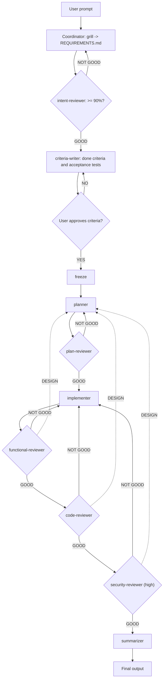

# H2O Swarm

**H**ydrogen writes, **O**pus attacks. Authors (planner, implementer) run on
Gemini 4 Hydrogen; every adversarial reviewer runs on Claude Opus 5.5, so no
work is reviewed by its own model family. Reviewers run at `medium` to save
tokens; only the deep security review runs at `high`.

`<skill-dir>` below means the folder containing this file. Gates are backed by
`<skill-dir>/scripts/h2o_gate.py`; the topology, models and loop limits live in
`<skill-dir>/swarm.config.json`, which the script reads directly.
`DESIGN.md` explains why; `README.md` is the human guide.

## Roles and models

**H2O has its own model ruleset:** the assignments below override any global
swarm routing rule or catalogue binding, including reviewer tier floors. Set
`model` explicitly on every `swarm{action:"add"}`; never let a worker inherit
the coordinator's model. Read `references/models.md` if any ID is not listed
in `swarm{action:"models"}` or a model runs out of quota.

| Role | Model | Workspace | Job |
| :--- | :--- | :--- | :--- |
| coordinator | user's choice | - | Grills the user, routes work, runs the gate script, talks to the user |
| `intent-reviewer` | `claude-opus-5-5-medium` | `inherit` | Verifies >= 90% confidence in the grilled requirements |
| `criteria-writer` | `gemini-4-hydrogen-high` | `inherit` | Writes binary done criteria and acceptance tests |
| `planner` | `gemini-4-hydrogen-xhigh` | `inherit` | Writes the implementation plan |
| `plan-reviewer` | `claude-opus-5-5-medium` | `inherit` | Attacks the plan against the criteria |
| `implementer` | `gemini-4-hydrogen-high` (to `-xhigh` after its first NOT GOOD) | `inherit` | Builds on branch `h2o/<slug>` |
| `functional-reviewer` | `claude-opus-5-5-medium` | `inherit` | Attacks behaviour: runs acceptance tests, tries to break it |
| `code-reviewer` | `claude-opus-5-5-medium` | `inherit` | Attacks code quality, maintainability and test integrity |
| `security-reviewer` | `claude-opus-5-5-high` | `inherit` | Deep security scan and threat review |
| `summarizer` | `gemini-4-hydrogen-high` | `inherit` | Writes the final report |
| `monitor` | `gemini-4-hydrogen-medium` | `inherit` | Stall monitor (`swarm_monitor` skill) |

One implementer works on `inherit`, so reviewers see its changes directly.
Reviews run one at a time, so at most one Opus worker is busy at once.

## Workflow



## Coordinator protocol

**Read `references/briefs.md` before adding any worker** and brief it from
the matching template. Every brief tells the worker to ground itself in
`.gemini/knowledge/` (if present) and the named files before acting.

### 0. Start
1. `swarm{action:"title", title:"h2o: <task>"}`.
2. Add `monitor` (`gemini-4-hydrogen-medium`) with the monitor brief. Add
   `narrator` too if `swarm_narrator` is in your skill list.
3. Add each other worker when its stage starts, not all up front.

### 1. Grill and intent review (`intent-reviewer`)
Workers cannot talk to the user, so you grill. Load the `grill` skill, ask one
question at a time with a recommended answer, and write
`.agents/h2o/REQUIREMENTS.md` (the Q&A log and the requirements). Then
`intent-reviewer` attacks it for ambiguity, contradictions and unstated
assumptions. If it returns `NOT GOOD`, ask the user its findings, update
`REQUIREMENTS.md`, and re-run `intent-reviewer` until `GOOD`.

### 2. Done criteria (`criteria-writer`)
It writes `.agents/h2o/CRITERIA.md` (binary criteria, non-goals, proving
commands) and, where the repo has a test suite, failing acceptance tests.
Show the criteria to the user with `ask_question`; loop until approved. Then
freeze them:

```bash
python3 <skill-dir>/scripts/h2o_gate.py freeze --state-dir .agents/h2o \
  --file .agents/h2o/CRITERIA.md --file <each acceptance test>
```

### 3. Plan, then plan review
`planner` writes `.agents/h2o/PLAN.md`; `plan-reviewer` attacks it. NOT GOOD
goes back to `planner`, citing the review `#seq`.

### 4. Implement
`implementer` builds on `h2o/<slug>`, adds regression tests, commits each
attempt, and pastes the output of the test suite, `check-frozen` and
`diff-guard` with its post.

### 5. Three reviews, in order
Each review only sees code that passed the one before it.
1. `functional-reviewer`: runs the suite and every criterion's command, then
   tries to break the change.
2. `code-reviewer`: follows `skills/review/SKILL.md`, runs linters and type
   checkers, checks scope, and runs `diff-guard` and `check-frozen` (either
   failing is NOT GOOD).
3. `security-reviewer`: follows `skills/security-review/SKILL.md`; every
   finding needs an exploit path.

After any rework, **all three** reviews run again in order. Reviewers report;
they never fix code.

### 6. Route every verdict through the gate script
**Read `references/verdicts.md` before routing the first verdict.** For each
reviewer post:

```bash
python3 <skill-dir>/scripts/h2o_gate.py verdict --file <post.md>
python3 <skill-dir>/scripts/h2o_gate.py record --state-dir .agents/h2o \
  --gate <gate> --verdict <GOOD|NOT_GOOD|DESIGN>
```

- `verdict` reports `MALFORMED` (no evidence, no numbered findings, or not
  exactly one `VERDICT:` line): send it back to the reviewer; do not record.
- `record` prints `next_stage` and, after the implementer's first NOT GOOD,
  `escalate_implementer_to`: switch it with `swarm{action:"model"}`.
- `record` exits **3** when a gate reaches 3 NOT GOOD verdicts (a `DESIGN`
  verdict counts against the plan gate). Stop and ask the user with
  `ask_question`: **stop** (summarise the best attempt and open findings) or
  **continue** (`h2o_gate.py grant --gate <gate>` adds 3 attempts).

### 7. Summary and output
`summarizer` writes the report from the board and `h2o_gate.py status`:
criteria met with evidence, what changed, attempts per gate, remaining risks.
Post `[done] <summary>` with no `@` so the monitor goes quiet, then give the
user the report. Push to a remote only if the user asks.
