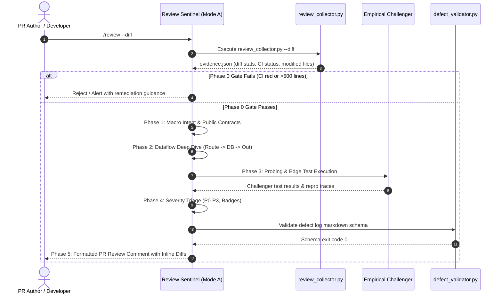
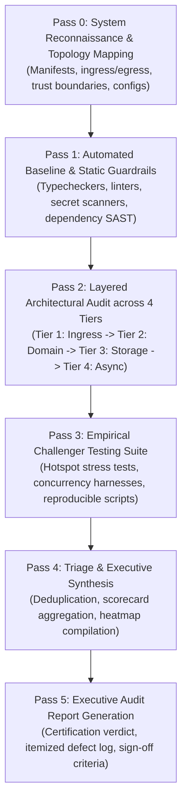

# Review Execution Pipelines: Dual-Mode Architecture

> **Purpose:** Detailed step-by-step execution workflows for both micro PR diff reviews and macro repository QE audits.
> **Router Dispatch:**
> - `/review` or `/review --diff` $\rightarrow$ **Mode A: Pull Request / Local Diff Review Pipeline**
> - `/review --repo` or `/review --audit` $\rightarrow$ **Mode B: Macro Repository Quality Engineering Audit Pipeline**
> **Standard:** Read on-demand per Progressive Disclosure rules. Every finding produced across these pipelines must conform to [`schemas.md`](file:///Users/ksprashanth/code/github/agent-skill-forge/skills/review/references/schemas.md).

---

## 1. Dual-Mode Execution Architecture

```mermaid
flowchart TD
    Trigger["Trigger: /review [args]"] --> Router{"Inspect Flags & Context"}

    Router -->|"/review" or "/review --diff"| ModeA["Mode A: Pull Request / Local Diff Review\n(Incremental feature change or staged diff)"]
    Router -->|"/review --repo" or "/review --audit"| ModeB["Mode B: Macro Repository Audit\n(Full codebase, release certification)"]

    subgraph ModeAPipeline ["Mode A: Micro PR Review Lifecycle"]
        A0["Phase 0: CI Triage & Diff Gate (<500 lines)"] --> A1["Phase 1: Macro Intent & Public Contracts"]
        A1 --> A2["Phase 2: Dataflow-Driven Micro Deep Dive"]
        A2 --> A3["Phase 3: The Empirical Challenger"]
        A3 --> A4["Phase 4: Triage & Severity Assignment"]
        A4 --> A5["Phase 5: Feedback Delivery & Inline Diffs"]
    end

    subgraph ModeBPipeline ["Mode B: Macro Repository Audit Lifecycle"]
        B0["Pass 0: Topology Recon & Boundary Mapping"] --> B1["Pass 1: Automated Baseline & Static Guardrails"]
        B1 --> B2["Pass 2: Layered Architectural Audit across 4 Tiers"]
        B2 --> B3["Pass 3: Empirical Challenger Testing Suite"]
        B3 --> B4["Pass 4: Triage & Synthesis"]
        B4 --> B5["Pass 5: Executive Audit Report Generation"]
    end

    ModeA --> ModeAPipeline
    ModeB --> ModeBPipeline
```

---

## 2. Mode A: Pull Request / Local Diff Review Pipeline

**Context:** Invoked on local staged diffs (`git diff --staged`), feature branches (`git diff origin/main...HEAD`), or GitHub pull requests. Optimized for velocity, developer ergonomics, and preventing regression introduction.



---

### Phase 0: CI Triage & Diff Gate Check

**Objective:** Protect reviewer cognitive bandwidth by refusing to review broken, unverified, or overly massive changes.

1. **Execute Evidence Collector:**
   ```bash
   python3.12 skills/review/scripts/review_collector.py --diff
   ```
   Inspect generated `evidence.json`.

2. **CI Status Gate:**
   - Check if project unit tests, typechecks, or linters are failing on the current branch.
   - **Gate Decision:** If CI is red or build fails, halt review immediately.
   - **Remediation Message:**
     > "CI is currently failing with compilation/test errors. Per engineering standards, code review requires a passing automated baseline. Please resolve build and test failures before requesting review."

3. **Diff Size Gate (<500 Lines of Logic):**
   - Count modified lines of functional logic (excluding lockfiles, generated protobufs, mock fixtures, and snapshots).
   - **Gate Decision:** If functional changes exceed 500 lines, flag a structural review warning.
   - **Recommendation:** Advise the author to split the work into stacked PRs:
     - *PR 1:* Database migrations & shared schemas.
     - *PR 2:* Core domain service logic & unit tests.
     - *PR 3:* API routes, controllers, and UI integration.

4. **Intent & Issue Linkage:**
   - Verify the PR includes a link to the issue/ticket and a concise summary explaining *why* the change was made, what user behavior changes, and any non-obvious trade-offs.

---

### Phase 1: Macro Intent & Public Contracts (Outside-In)

**Objective:** Understand what *should* happen before inspecting *how* it was implemented.

1. **Understand Problem Domain:**
   - Read the PR description, user story, and acceptance criteria.
   - Identify the user problem being solved and system boundaries impacted.

2. **Inspect Public Contracts First:**
   - Review schema migrations (`migrations/`, `db/schema.sql`, `prisma/schema.prisma`).
   - Review interface and type definitions (OpenAPI specifications, Protobuf definitions, GraphQL schemas, TypeScript types).
   - Review domain entity models.

3. **Evaluate Architectural Fit:**
   - Does this approach align with existing system conventions and design patterns?
   - Does it introduce unintended statefulness, break service boundaries, or create circular dependencies?

---

### Phase 2: Dataflow-Driven Micro Deep Dive

**Objective:** Trace execution along runtime dataflow paths rather than arbitrary file order.

1. **The Anti-Alphabetical Rule:**
   - **NEVER** review files in alphabetical order (`a_controller.py`, `b_model.py`, `c_util.py`). Alphabetical review fragments context and hides architectural flaws.
   - Trace the logical request path from external ingress to persistence and egress:
     $$\text{Route / Controller} \longrightarrow \text{Domain Service} \longrightarrow \text{Persistence / DB Query} \longrightarrow \text{Outgoing Events / Responses}$$

2. **Apply the 5 Core Axioms at Each Function:**
   - *Axiom 1: Invariants* — What preconditions and postconditions must hold true before and after this function executes?
   - *Axiom 2: Failure Modes* — What happens if this external call fails, drops connection, returns 500, or times out? Are resources cleaned up?
   - *Axiom 3: Nullability & Bounds* — Can any input or lookup result be `null`, `undefined`, empty, or negative? Are boundaries safely guarded?
   - *Axiom 4: Concurrency* — What happens if two concurrent requests or workers execute this block with the identical entity ID at the same millisecond?
   - *Axiom 5: Authorization* — Does this function enforce tenant bounding (`org_id`) and role permissions before accessing or mutating data?

3. **Cross-Check with the 8-Axis Checklist:**
   - Systematically cross-examine modified lines against [`checklist.md`](file:///Users/ksprashanth/code/github/agent-skill-forge/skills/review/references/checklist.md).

---

### Phase 3: The Empirical Challenger (Adversarial Probing)

**Objective:** Prove defects empirically through execution rather than speculative opinion.

1. **Checkout and Verify Locally:**
   - Verify the branch is cleanly checked out in the workspace.
   - Run the relevant test suite:
     ```bash
     npm test # or pytest, cargo test, go test ./...
     ```

2. **Proactive Adversarial Probing:**
   - **Boundary Fuzzing:** Probe endpoints with unexpected payloads (empty collections, zero values, negative numbers, maximum integers, strings with unicode control characters).
   - **Multi-Tenant Leakage Check:** Craft an adversarial test asserting that Tenant A's session token cannot read, update, or delete Tenant B's entity.
   - **Concurrency Collision:** Where check-then-act logic exists, write a concurrent execution test simulating simultaneous calls to expose race conditions.
   - **Rollback Verification:** If a database migration was added, execute the down-migration and confirm the database state remains clean and usable.

3. **Capture Reproduction Fixtures:**
   - For every discovered defect, write a minimal, self-contained test fixture proving the bug.

---

### Phase 4: Severity Triage & Badging

**Objective:** Classify each finding using the standardized severity taxonomy defined in [`schemas.md`](file:///Users/ksprashanth/code/github/agent-skill-forge/skills/review/references/schemas.md).

1. **Assign Standardized Severity Badges:**
   - 🔴 **`[P0: Critical - Blocker]`**: Security exploit, data corruption, critical path crash. Zero workaround. Hard merge blocker.
   - 🟠 **`[P1: High - Blocker]`**: Business invariant violation, TOCTOU race condition, resource leak, breaking public contract. Hard merge blocker.
   - 🟡 **`[P2: Medium - Important]`**: Edge-case logic defect, unindexed query, missing edge validation. Soft blocker (requires lead sign-off).
   - 🟢 **`[P3: Low - Suggestion/Nit]`**: Non-blocking code hygiene, dead code, single-use wrapper cleanup. Non-blocking.
   - ❓ **`[Question / Discussion]`**: Socratic inquiry into design decisions or requirements. Non-blocking.

2. **Strict Blocker Invariant:**
   - Never downgrade a P0 or P1 finding to unblock delivery timelines.

---

### Phase 5: Feedback Delivery & Inline Diffs

**Objective:** Deliver actionable, drop-in remediations that respect author time and facilitate quick turnaround.

1. **Structure Feedback Using PR Review Template:**
   - Lead with an Executive Summary indicating clear verdict (Approval, Changes Requested, Needs Discussion).
   - Highlight commendable engineering, clean tests, or elegant patterns.
   - Format each defect with exact file:line coordinates, root cause, empirical proof, and `# Before` vs. `# After` code blocks.

2. **Run L3 Schema Validator:**
   ```bash
   python3.12 skills/review/scripts/defect_validator.py --file <review_output.md>
   ```
   Ensure the output passes all schema and coordinate checks.

3. **Prompt Re-Review:**
   - When the author pushes fixes, promptly re-verify the targeted diff to keep development velocity high.

---

## 3. Mode B: Macro Repository Quality Engineering Audit Pipeline

**Context:** Invoked on complete repositories, release candidates, system re-architectures, or compliance/security certifications. Provides an exhaustive, top-to-bottom health audit.



---

### Pass 0: System Reconnaissance & Topology Mapping

**Objective:** Build a complete mental and mechanical model of the repository architecture before reading source code.

1. **Inventory Workspace Manifests:**
   - Identify language runtimes and package manifests:
     `package.json`, `Cargo.toml`, `go.mod`, `pyproject.toml`, `pom.xml`, `build.gradle`.
   - Parse declared dependencies, build scripts, test commands, and toolchain configurations.

2. **Map Ingress and Egress Trust Boundaries:**
   - **Ingress Endpoints:** Public HTTP routes, GraphQL resolvers, WebSocket listeners, gRPC services, queue consumers, CLI commands.
   - **Egress Connections:** Database connection pools, Redis caches, third-party REST/gRPC clients, outgoing webhook dispatchers, cloud object stores (S3/GCS).

3. **Audit Environment & Infrastructure Contracts:**
   - Inspect `.env.example`, Dockerfiles, `docker-compose.yml`, Kubernetes manifests, Terraform scripts, and CI/CD pipelines (`.github/workflows/`).
   - Identify secret injection mechanisms, runtime privileges, storage volume mounts, and network exposure policies.

---

### Pass 1: Automated Baseline & Static Guardrails

**Objective:** Run the full automated verification toolchain to establish baseline health without consuming human review energy.

1. **Execute Evidence Collector in Repository Mode:**
   ```bash
   python3.12 skills/review/scripts/review_collector.py --repo
   ```
   The script inspects the repository, runs installed static analysis tools, and outputs `evidence.json`.

2. **Automated Baseline Verification Matrix:**

| Dimension | Command / Tool Archetype | Gate Expectation |
| :--- | :--- | :--- |
| **Type Integrity** | `tsc --noEmit`, `mypy --strict`, `cargo check`, `go vet` | Zero type errors or implicit `any` escapes. |
| **Linters & Style** | `eslint`, `ruff check`, `golangci-lint`, `clippy` | Zero errors; audit suppression comments (`eslint-disable`, `# noqa`). |
| **Secret Scanning** | `gitleaks detect`, `trufflehog` | Zero plaintext credentials or hardcoded keys. |
| **Dependency SAST** | `npm audit`, `pip-audit`, `cargo audit`, `trivy` | Flag CVEs with CVSS $\ge 7.0$ (High/Critical). |
| **Dead Code** | `knip`, `deadcode`, `vulture` | Identify zombie modules, unused exports, and orphan assets. |

3. **Record Findings in Evidence Document:**
   - All automated static findings are cataloged under Tier 1 (Automated) and linked in the audit appendix.

---

### Pass 2: Layered Architectural Audit across 4 Tiers

**Objective:** Audit the codebase systematically top-down through four distinct architectural layers.

```
┌────────────────────────────────────────────────────────────────────────┐
│               THE 4-TIER ARCHITECTURAL AUDIT PYRAMID                   │
├────────────────────────────────────────────────────────────────────────┤
│  Tier 1: Ingress, API, and Edge Serialization Boundary                 │
│  • Schema validation, auth gates, rate limiting, error masking         │
├────────────────────────────────────────────────────────────────────────┤
│  Tier 2: Domain Logic, State Management & Business Invariants          │
│  • State transitions, transaction boundaries, math precision, side effects│
├────────────────────────────────────────────────────────────────────────┤
│  Tier 3: Persistence, Storage & Data Access                            │
│  • Query indexing, N+1 eradication, ACID transactions, migrations      │
├────────────────────────────────────────────────────────────────────────┤
│  Tier 4: Asynchronous Processing, Messaging & Infrastructure           │
│  • Queues, idempotency, retry backoff, I/O timeouts, SIGTERM draining  │
└────────────────────────────────────────────────────────────────────────┘
```

#### Tier 1: Ingress, API, and Serialization Boundary
- Audit parameter parsing, schema validation (Zod, Pydantic, Protobuf), and sanitization.
- Check authentication gates, token verifications, and tenant-isolation middleware.
- Verify HTTP response status codes, error masks (forbid leaking stack traces to clients), and rate limiting.

#### Tier 2: Domain Logic & State Management
- Verify state machines: are transitions atomic and validated? Can an entity be stuck in an illegal state?
- Audit boundary invariants: check off-by-one errors, null/undefined propagation, integer overflow, and floating-point math on currencies.
- Identify hidden side effects in pure functions or query handlers.

#### Tier 3: Persistence & Data Access
- Audit SQL queries: look for unindexed `WHERE`/`ORDER BY` clauses, full table scans, and unbounded `SELECT *` without `LIMIT`.
- Check transaction boundaries: do multi-table updates execute inside ACID transactions with appropriate isolation levels?
- Detect N+1 query patterns inside loops or ORM relation accessors.

#### Tier 4: Asynchronous Processing & Integrations
- Inspect worker queues, retries, and dead-letter queue (DLQ) configurations.
- Verify message idempotency: if an event is delivered twice, does it corrupt data?
- Inspect timeout policies, circuit breakers, and connection pool exhaustion guards on outbound HTTP/RPC clients.

---

### Pass 3: Empirical Challenger Testing Suite

**Objective:** Validate suspected vulnerabilities dynamically by writing standalone reproduction fixtures.

1. **Target Critical Hotspots:**
   - Concurrency race conditions (e.g., balance updates, inventory reservation, token refresh).
   - Multi-tenant data leakage (cross-tenant IDOR).
   - Resource exhaustion under burst traffic (unbounded memory buffering, missing timeouts).

2. **Author Reproducible Test Fixtures:**
   - Create isolated test scripts in `test/challenger/` or temporary harness files.
   - Run parallel execution harnesses (e.g., 50 simultaneous parallel requests against an un-locked balance check).
   - Assert failure against the existing code to verify defect validity before logging.

---

### Pass 4: Triage & Synthesis

**Objective:** Synthesize itemized findings into high-level patterns, eliminate duplicates, and construct risk heatmaps.

1. **Deduplication:**
   - Group related symptoms that stem from a single shared architectural root cause (e.g., 12 missing auth checks caused by a missing router middleware).

2. **Scorecard Compilation:**
   - Calculate total defects by severity level (P0, P1, P2, P3).
   - Construct the Findings Heatmap by Module to pinpoint high-risk subsystems.

3. **Determine Certification Verdict:**
   - **`REJECTED`**: One or more P0 Critical or P1 High blockers remain open.
   - **`CONDITIONALLY APPROVED`**: Zero P0/P1 blockers; P2 findings exist with approved remediation timeline.
   - **`CERTIFIED`**: Zero P0, P1, or P2 blockers; codebase satisfies all 8 QE inspection axes.

---

### Pass 5: Executive Audit Report Generation

**Objective:** Emit the formal Executive Audit Report formatted per [`schemas.md`](file:///Users/ksprashanth/code/github/agent-skill-forge/skills/review/references/schemas.md).

1. **Compile Executive Dashboard:**
   - Include Executive Summary, Findings Scorecard, Module Heatmap, Full Itemized Defect Log, and Sign-off Criteria.

2. **Validate Defect Schema:**
   ```bash
   python3.12 skills/review/scripts/defect_validator.py --file <audit_report.md>
   ```

3. **Deliver Handoff:**
   - Present report to engineering leadership and engineering team with clear next actions.
